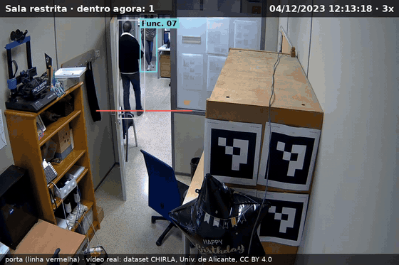
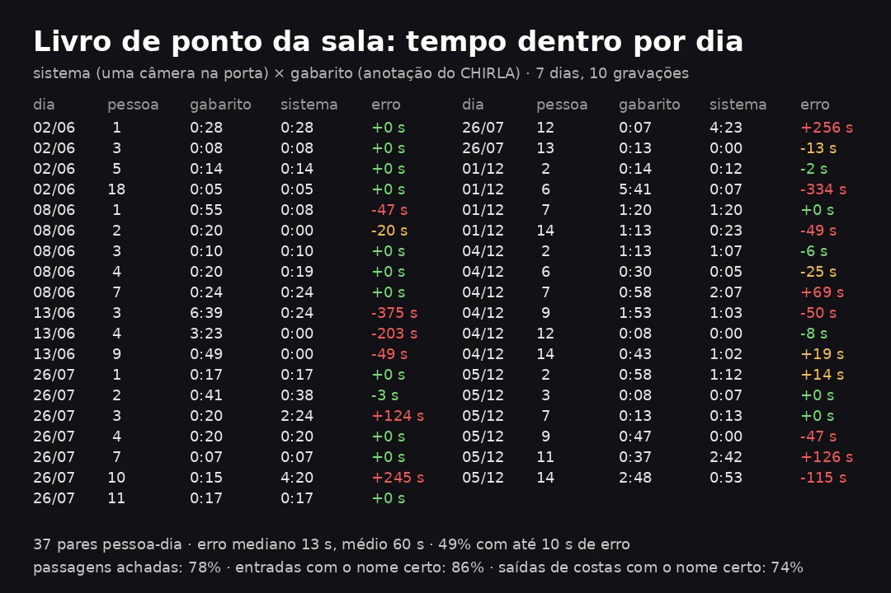
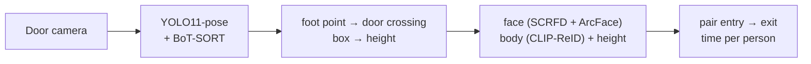
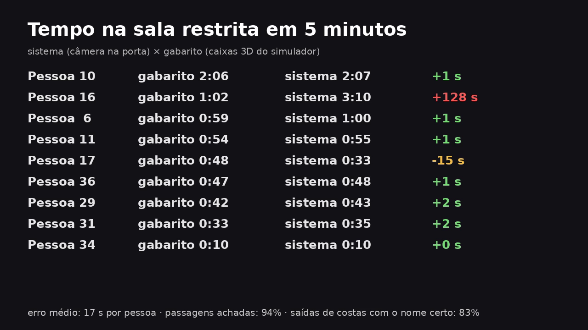
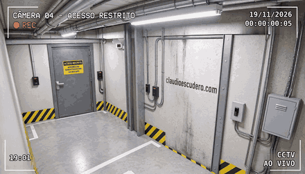
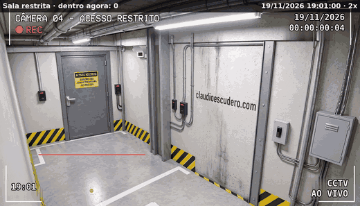

# dwellscope: who went into the restricted room, and for how long

🌐 **English** · [Português (Brasil)](README.pt-BR.md)

**One camera at the door of a restricted room: who went in, who came out, and how long each person stayed, with no badge reader.**

> A personal study by **Claudio Escudero** ([claudioescudero.com](https://claudioescudero.com) · [linkedin.com/in/claudioescudero](https://www.linkedin.com/in/claudioescudero/)). It is not a product or a library.

<p align="center">
  
</p>

**The question:** cold rooms, radiation areas and vaults have a time limit for safety. Can one camera at the door log how long each worker spent inside? That means identifying who goes in and recognizing when that same person comes out. On the way in they face the camera, so the face names them. On the way out only their back shows, so they have to be recognized by clothes, hair and height.

**Short answer:** yes, and the door is the weak part. On 47 minutes of a real office (14 people, 7 days), the face named 86% of the entries, and clothes and hair named every exit in the exit test (11 of 11; chance was 47%). The time-in-room log had a median error of 13 s per person per day. Most of the rest comes from the tracker missing 22% of the crossings in a small, crowded doorway.

<p align="center"></p>

**To run it on your own video**, you only need [`scripts/dwellscope.py`](#trying-your-own-video). The `chirla/` and `smartspaces/` scripts only reproduce the study.

## The data

| Data | What the study uses | Download | License |
|---|---|---|---|
| [CHIRLA](https://github.com/bdager/CHIRLA) (real, [arXiv 2502.06681](https://arxiv.org/abs/2502.06681)) | Camera 1: a small office with one door, 10 recordings, 47 min, 136 crossings by 14 people (1.36 GB) | [ScienceDB](https://doi.org/10.57760/sciencedb.20543) via [`00_download.py`](scripts/chirla/00_download.py), or the [Hugging Face mirror](https://huggingface.co/datasets/bdager/CHIRLA) | CC BY 4.0 |
| [NVIDIA PhysicalAI-SmartSpaces](https://huggingface.co/datasets/nvidia/PhysicalAI-SmartSpaces) (synthetic MVP) | Scene `Hospital_000`, `Camera_21`: 5 min, 49 crossings by 9 people, with 3D ground truth (~0.6 GB) | [Hugging Face](https://huggingface.co/datasets/nvidia/PhysicalAI-SmartSpaces/tree/main/MTMC_Tracking_2025/val/Hospital_000) | CC BY 4.0 |
| `restricted_room` sample | One 45 s clip for `dwellscope.py` (31 MB) | [YouTube](https://youtu.be/CjTEk33Sr8Y), see [`samples/README.md`](samples/README.md) | the author's |

Both datasets label every person in every frame, so running their labels through the same door rule gives the answer key. CHIRLA has no calibration, so its door lines are hand-drawn, in pixels.

## How it works



1. **Track.** YOLO11s-pose finds people and BoT-SORT links them frame to frame.
2. **Cross.** The bottom of each box is the foot point. A person changes side only after going a margin past the door line, and an in-and-out within 2 s (someone standing in the doorway) is dropped.
3. **Identify.** An entry is named by face first, then by clothes and height, else it is a new person. An exit is matched only against the people inside.
4. **Log.** Each entry is paired with the same person's next exit.

| Model | Job | Trained on |
|---|---|---|
| **YOLO11s-pose** (Ultralytics) | Person boxes | [COCO](https://cocodataset.org/) |
| **SCRFD-10GF** (InsightFace `buffalo_l`) | Find the face | [WIDER FACE](http://shuoyang1213.me/WIDERFACE/) |
| **ArcFace ResNet-50** (InsightFace `buffalo_l`) | Whose face (match at cosine ≥ 0.25) | WebFace600K ([WebFace260M](https://www.face-benchmark.org/)) |
| **CLIP-ReID** (ONNX) | Clothes and hair, from any side | [Market-1501](https://zheng-lab-anu.github.io/Project/project_reid.html) |

All are off the shelf; none was trained for this study. Height is not a model: it is box height fitted against foot position. Everything runs on the CPU; only tracking gains much from a GPU (the 10 CHIRLA recordings took 9 min on an L4).

## Results on real video (CHIRLA)

Door crossings: 106 of 136 found, 15 false (precision 88%, recall 78%). Truth: 14 people, 37 person-day rows.

| Cues | Entries named right | Exits named right | People created | Median time error | Rows within 10 s |
|---|---|---|---|---|---|
| Height only | 34% | 26% | 40 | 28 s | 24% |
| Clothes and hair | 34% | 42% | 40 | 20 s | 32% |
| Face only | 84% | 52% | 30 | 32 s | 38% |
| Face, clothes and hair | 80% | 70% | 21 | 13 s | 49% |
| **Face, clothes, hair and height** | **86%** | **74%** | 25 | 13 s | 49% |
| *Detected crossings, true names* | | | | *0.3 s* | *70%* |

Clothes cannot link days, because the participants changed outfits; the face rarely sees an exit. Together they work. Even with perfect names, 30% of the rows are off by more than 10 s: that is the missed crossings.

**Exit test** (given the true list of who is inside, name the person leaving; 11 exits): chance 47%, face 55%, height 73%, clothes and hair 100%.

## Results on synthetic video (MVP)

Door crossings: 46 of 49 found, 2 false. With face, clothes, hair and height: 22/23 entries and 19/23 exits named right, and 7 of 9 people within 2 s of their true time inside. The synthetic faces are poor, so here clothes did the work (exit test: 94%).

<p align="center"></p>

## What went wrong

| Finding | What changed |
|---|---|
| The tracker breaks people into short tracks in the doorway | Tracks that start within 1.5 s and 120 px of where another ended are joined, and the door margin went from 45 to 30 px. Recall 68% → 78% |
| In a crowded office, a person in front cuts the box and the foot point jumps | The foot point is the median of the last 0.5 s |
| One missed exit keeps a person "inside" until the video ends (+4 min) | Not fixed. `dwellscope.py` reports it under `warnings` |
| Faces are small (~25 px), so the usual 0.35 threshold was too strict | 0.25: entries named right 82% → 86% |
| ByteTrack swapped two people crossing together | BoT-SORT with appearance features |

## How to reproduce

**Requirements:** Linux, Python 3.12, [uv](https://docs.astral.sh/uv/), FFmpeg. A GPU helps only for CHIRLA tracking.

```bash
# 1. environment (CPU build of PyTorch; on a GPU machine use the CUDA build)
uv venv --python 3.12 .venv && source .venv/bin/activate
uv pip install -r requirements.txt --extra-index-url https://download.pytorch.org/whl/cpu

# 2. weights (~0.7 GB)
mkdir -p weights/insightface/models/buffalo_l
curl -L -o weights/yolo11s-pose.pt https://github.com/ultralytics/assets/releases/download/v8.3.0/yolo11s-pose.pt
curl -L -o weights/person_vit_clip_reid.onnx https://huggingface.co/occurra/person_vit_clip_reid/resolve/main/person_vit_clip_reid.onnx
curl -L -o /tmp/buffalo_l.zip https://github.com/deepinsight/insightface/releases/download/v0.7/buffalo_l.zip
unzip /tmp/buffalo_l.zip -d weights/insightface/models/buffalo_l
```

**Real video (CHIRLA):**

```bash
cd scripts/chirla
python 00_download.py         # ~8 min from ScienceDB, no account
python 01_ground_truth.py
python 02_track.py 3          # GPU: ~9 min
python 03_events.py
for m in face+body+height face+body body+height body height face; do python 04_identify.py $m; done
python 05_evaluate.py
python 06_video.py seq_025 face+body+height 3
```

**Synthetic MVP (SmartSpaces):**

```bash
U=https://huggingface.co/datasets/nvidia/PhysicalAI-SmartSpaces/resolve/main/MTMC_Tracking_2025/val/Hospital_000
mkdir -p data/raw/smartspaces/Hospital_000/videos && cd data/raw/smartspaces/Hospital_000
curl -LO $U/calibration.json -LO $U/ground_truth.json -LO $U/map.png
curl -L -o videos/Camera_21.mp4 $U/videos/Camera_21.mp4
cd - && cd scripts/smartspaces
python 01_ground_truth.py
python 02_track.py            # ~17 min on CPU
python 03_events.py
for m in face+body+height body+height body height face; do python 04_identify.py $m; done
python 05_evaluate.py
python 06_video.py face+body+height 4
```

Output goes to `data/output/{chirla,smartspaces}/`.

### Trying your own video

[`scripts/dwellscope.py`](scripts/dwellscope.py) runs the whole pipeline on one video: video and door file in, JSON history out, and an annotated video if you ask. It needs only steps 1 and 2 above. With the [sample](samples/README.md) downloaded:

```bash
python scripts/dwellscope.py samples/restricted_room.mp4 \
    --door samples/restricted_room.door.json \
    --out history.json \
    --video-out annotated.mp4 --speed 2
```

About 1.5 min on a 16-thread CPU. Without `--out` the JSON is printed; without `--video-out` no video is made.

| In: `samples/restricted_room.mp4` | Out: `annotated.mp4` |
|---|---|
|  |  |

**Out: `history.json`** (trimmed):

```json
{
 "events": [
  {"time_s": 4.0,   "kind": "enter", "person": 1, "identified_by": "new",  "face_found": true},
  {"time_s": 12.12, "kind": "enter", "person": 2, "identified_by": "new",  "face_found": true},
  {"time_s": 17.62, "kind": "enter", "person": 3, "identified_by": "new",  "face_found": true},
  {"time_s": 28.38, "kind": "exit",  "person": 2, "identified_by": "look", "score": 0.905, "face_found": false},
  {"time_s": 35.75, "kind": "exit",  "person": 3, "identified_by": "look", "score": 0.847, "face_found": false},
  {"time_s": 42.71, "kind": "exit",  "person": 1, "identified_by": "only one inside", "face_found": false}
 ],
 "visits": [
  {"person": 1, "enter_at": "2026-11-19T19:01:04", "exit_at": "2026-11-19T19:01:42", "duration_s": 38.7},
  {"person": 2, "enter_at": "2026-11-19T19:01:12", "exit_at": "2026-11-19T19:01:28", "duration_s": 16.3},
  {"person": 3, "enter_at": "2026-11-19T19:01:17", "exit_at": "2026-11-19T19:01:35", "duration_s": 18.1}
 ],
 "people": [{"person": 1, "visits": 1, "time_inside_s": 38.7}, "..."],
 "warnings": []
}
```

`identified_by` says what named each crossing: `face`, `look` (clothes and height), `new`, or `only one inside`. `warnings` lists what the log cannot close by itself: an exit with no entry, an entry with no exit, or two entries in a row.

**The door file** is the only per-camera setting: two points of the door line, in pixels, and any point inside the room ([`samples/restricted_room.door.json`](samples/restricted_room.door.json)):

```json
{"line": [[200, 810], [760, 810]], "inside": [480, 1000], "margin_px": 30, "start": "2026-11-19T19:01:00"}
```

`margin_px` (how far past the line counts as a crossing) and `start` (wall-clock time of the first frame) are optional. Check the line before running:

```bash
python scripts/dwellscope.py video.mp4 --door door.json --check door.png
```

Other flags: `--start`, `--cues` (`face+body+height`, `body`, `face`…), `--imgsz`, `--conf`, `--weights`.

**Frame rate.** Every frame is not needed. On the sample, 24 down to 3 fps gave the same log, and 2 fps missed crossings. **6 to 8 fps is a safe choice** (not measured on a crowded door). Convert first; the script reads the fps from the file:

```bash
ffmpeg -i video.mp4 -vf fps=8 -c:v libx264 -crf 18 -an video_8fps.mp4
```

## Repository layout

```
scripts/
  dwellscope.py       use it on your own video
  botsort_reid.yaml   tracker settings
  chirla/             reproduce the study, real video (00_download … 06_video)
  smartspaces/        reproduce the study, synthetic MVP (01_ground_truth … 06_video)
samples/              the sample's door file and its YouTube link
docs/media/           the images in this README
```

## Limitations

- Short recordings (2 to 9 min) of one small office; thresholds were tuned on the same data.
- Hand-drawn door lines and no calibration, so height is relative.
- People who never cross the door are invisible to a door log.
- `dwellscope.py` numbers people from 1 in each video and remembers nobody between runs.
- Face recognition on employees needs consent and a legal basis.

## Credits and licenses

- **Code:** © 2026 Claudio Escudero, [CC BY-NC 4.0](LICENSE), non-commercial use only. YOLO11 is AGPL-3.0 and the `buffalo_l` face weights are non-commercial research only.
- **Data:** [CHIRLA](https://github.com/bdager/CHIRLA) (Dominguez-Dager et al., University of Alicante) and [NVIDIA PhysicalAI-SmartSpaces](https://huggingface.co/datasets/nvidia/PhysicalAI-SmartSpaces), both CC BY 4.0. The `chirla_*` and `smartspaces_*` images in `docs/media/` are adapted from them and stay CC BY 4.0. The sample clip and `restricted_room_*.gif` are the author's.
- **Models:** [Ultralytics YOLO11](https://github.com/ultralytics/ultralytics) with BoT-SORT (Aharon et al., 2022), [InsightFace](https://github.com/deepinsight/insightface) SCRFD (Guo et al., 2022) and ArcFace (Deng et al., 2019), [CLIP-ReID](https://github.com/Syliz517/CLIP-ReID) (Li et al., 2023; ONNX by `occurra/person_vit_clip_reid`). Weights are downloaded from their authors, not redistributed.
