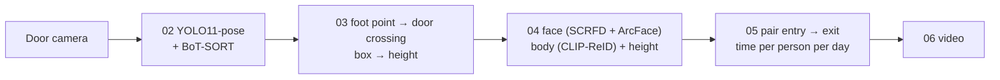

# dwellscope: who went into the restricted room, and for how long

🌐 **English** · [Português (Brasil)](README.pt-BR.md)

**One camera at the door of a restricted room: who went in, who came out, and how long each person stayed, with no badge reader.**

> A personal study by **Claudio Escudero** ([linkedin.com/in/claudioescudero](https://www.linkedin.com/in/claudioescudero/)). It is not a product or a library. The code is shared so others can read it, reproduce the results and try it on their own data.

<p align="center">
  
</p>

**The question:** cold rooms, radiation areas, machine rooms and vaults have a time limit for safety. Can one camera at the door audit how long each worker spent inside? Entries face the camera, so the face can name the person. Exits show only their back, so the system has to recognize them by clothes, hair and height.

**Short answer (real office video, 7 days):** the idea holds, and the door is the weak part. On 47 minutes of a real office with 14 people over 7 days, the face named 86% of the people walking in, and clothes and hair named everyone leaving with their back to the camera in the exit test (11 of 11; chance was 47%). Clothes only work within a day: the participants changed outfits between sessions, so the face is what links the days. The time-in-room log had a median error of 13 s per person per day, and half the rows were within 10 s. The rest broke on the door itself. The tracker missed 22% of the crossings in a small, crowded doorway, and one missed exit keeps a person "inside" until the recording ends.

<p align="center"></p>

The study ran in two phases: an MVP on synthetic video with exact ground truth, then real video. Both are reported below.

## The data

**Real video: [CHIRLA](https://github.com/bdager/CHIRLA)** (Dominguez-Dager et al., 2025, [arXiv 2502.06681](https://arxiv.org/abs/2502.06681), CC BY 4.0). A university lab building in Alicante, filmed on 7 days between June and December 2023 by 7 cameras, with 22 people who agreed to public release. Every person has an identity box in every frame, and the same number is the same person on every day. The participants were asked to change clothes between sessions.

The study uses **camera 1**: a small office (8.5 m², one door), filmed from the corner opposite the door. Entries walk toward the camera and exits walk away from it. There are 10 recordings, 2 to 9 minutes each, 47 minutes in total. Running the dataset's own identity boxes through the same door rule as the system gives the answer key: 136 door crossings by 14 people, and each person's time inside per day.

CHIRLA has no camera calibration, so everything is in pixels. The camera was remounted between July and December, so there are two door lines, drawn by hand.

**Synthetic MVP: [NVIDIA PhysicalAI-SmartSpaces](https://huggingface.co/datasets/nvidia/PhysicalAI-SmartSpaces)** (AI City Challenge 2025, CC BY 4.0). Calibrated multi-camera video with a 3D box for every person in every frame. The `Hospital_000` validation scene has 5 minutes at 30 fps and 41 people. A hall with an open side plays the restricted room (walls at x = −32.4 m and x = −23.5 m, door at y = 16 m), and `Camera_21`, inside it, looks at the door. The 3D boxes give 49 door crossings by 9 people, each person's true height and their exact time inside.

**Where to get it.** None of the data is in the repository. The commands are under [How to reproduce](#how-to-reproduce).

| Data | What the study uses | Size | Download | License |
|---|---|---|---|---|
| CHIRLA | Camera 1: 10 videos and their identity annotations | 1.36 GB + 21 MB | [ScienceDB](https://doi.org/10.57760/sciencedb.20543), no account (fetched by [`00_download.py`](scripts/chirla/00_download.py)), or the [Hugging Face mirror](https://huggingface.co/datasets/bdager/CHIRLA) after accepting its terms | CC BY 4.0 |
| NVIDIA PhysicalAI-SmartSpaces | The `Hospital_000` validation scene: `Camera_21`, calibration and 3D ground truth | ~0.6 GB | [Hugging Face](https://huggingface.co/datasets/nvidia/PhysicalAI-SmartSpaces/tree/main/MTMC_Tracking_2025/val/Hospital_000), no account (`curl`) | CC BY 4.0 |
| `restricted_room` sample | One 45 s clip, for [`dwellscope.py`](scripts/dwellscope.py) | 31 MB | [YouTube](https://youtu.be/CjTEk33Sr8Y), with `yt-dlp` (see [`samples/README.md`](samples/README.md)) | the author's |

## How it works



The real-video pipeline is in [`scripts/chirla/`](scripts/chirla/) and the synthetic one in [`scripts/smartspaces/`](scripts/smartspaces/). Each has one script per step and a `config.py`; the tracker settings ([`botsort_reid.yaml`](scripts/botsort_reid.yaml)) are shared.

| Step | Real video ([`scripts/chirla/`](scripts/chirla/)) | Synthetic ([`scripts/smartspaces/`](scripts/smartspaces/)) |
|---|---|---|
| 0 | [`00_download.py`](scripts/chirla/00_download.py): downloads camera 1 from ScienceDB in parallel pieces | `curl` commands under [How to reproduce](#how-to-reproduce) |
| 1 | [`01_ground_truth.py`](scripts/chirla/01_ground_truth.py): runs CHIRLA's identity boxes through the door rule to get the true crossings | [`01_ground_truth.py`](scripts/smartspaces/01_ground_truth.py): the same from the 3D boxes, plus true heights |
| 2 | [`02_track.py`](scripts/chirla/02_track.py): YOLO11s-pose at 640 px and BoT-SORT with appearance features ([`botsort_reid.yaml`](scripts/botsort_reid.yaml)), one process per recording, on a GPU | [`02_track.py`](scripts/smartspaces/02_track.py): the same at 960 px, on the CPU |
| 3 | [`03_events.py`](scripts/chirla/03_events.py): joins tracks the tracker broke in the doorway, then finds the crossings of a hand-drawn door line (pixels). Relative height comes from box height against foot position, fitted once per camera mount | [`03_events.py`](scripts/smartspaces/03_events.py): foot point to the floor through the calibration; height in metres from the box top |
| 4 | [`04_identify.py`](scripts/chirla/04_identify.py): entry, face first, then clothes from earlier the same day, else a new person. Exit: the best of the people inside on clothes, height and face | [`04_identify.py`](scripts/smartspaces/04_identify.py): one score, body cosine − 2 × height difference + 0.3 × face cosine |
| 5 | [`05_evaluate.py`](scripts/chirla/05_evaluate.py): matches crossings (same recording, same direction, within 3 s), maps system people to true people one to one over all days, sums time per person per day, runs the exit test | [`05_evaluate.py`](scripts/smartspaces/05_evaluate.py): the same for one scene |
| 6 | [`06_video.py`](scripts/chirla/06_video.py): one recording with names, the door line, a "dentro agora" (inside now) counter and the full day log at the end | [`06_video.py`](scripts/smartspaces/06_video.py) |

Both pipelines share the rules that matter:
- A person changes side only after going a margin past the door line (30 px on the real video, 0.4 m on the synthetic one).
- A new track gets its side only once it is clearly off the line.
- Opposite crossings by the same track within 2 s are someone standing in the doorway, and both are dropped.
- An exit is matched only against the people the system thinks are inside.

### The models

Four trained models run in the pipeline. They are all off the shelf: none was trained or fine-tuned for this study. Each answers one question.

| Model | Question it answers | In → out | Size | Trained on |
|---|---|---|---|---|
| **YOLO11s-pose** (Ultralytics, 2024) | Where is each person in the frame? | The frame, resized to 640 px (960 on the synthetic scene) → a box, a confidence and 17 body keypoints per person | 9.9 M parameters, 23.4 GFLOPs, 20 MB | COCO-Pose |
| **SCRFD-10GF** (`det_10g`, InsightFace `buffalo_l`; Guo et al., 2022) | Is there a face in this crop, and where? | The top half of a person crop, upscaled to 640 px → face boxes, five landmarks and a score | 17 MB | WIDER FACE |
| **ArcFace ResNet-50** (`w600k_r50`, InsightFace `buffalo_l`; Deng et al., 2019) | Whose face is this? | A 112 × 112 face, aligned on the landmarks → a 512-number vector | 174 MB | WebFace600K |
| **CLIP-ReID** (ViT image encoder from CLIP; Li et al., 2023) | Who is wearing these clothes, with this hair? | A person crop, resized to 256 × 128 → a 512-number vector | 345 MB (ONNX) | Market-1501 |

How each one is used:

- **YOLO11s-pose** only looks for the person class. The door rule uses the bottom of the box as the foot point, and the box height gives the relative height. The keypoints are saved, but no rule uses them yet.
- **BoT-SORT** (Aharon et al., 2022) joins the boxes from frame to frame into tracks. It is not a separate network: it predicts each box's motion with a Kalman filter and matches boxes by overlap and by appearance, taken from the detector's own features. The settings are in [`botsort_reid.yaml`](scripts/botsort_reid.yaml): a 60-frame buffer, and no camera motion compensation, because the camera does not move.
- **SCRFD** runs on up to 8 crops per crossing, picked among the largest boxes within 2 s of it. A face counts only with a score of at least 0.60, so the camera must see the face clearly, which happens on entries and almost never on exits.
- **ArcFace** turns the best face into a vector. Two faces whose vectors have a cosine of 0.25 or more are the same person. The usual threshold is 0.35; at about 25 px, the faces here are small (see [What went wrong](#what-went-wrong)).
- **CLIP-ReID** turns each crop into a vector of how the person looks, mostly clothes and hair, and averages the crops of one crossing. It was trained to re-identify pedestrians between outdoor campus cameras, from any side, so it works from behind too. That is what names the exits. Clothes change between days, so these vectors are only compared within the same day.
- **Height** is not a model. It is a straight line fitted on the video: box height against foot position (see step 3).

Only the two face models of `buffalo_l` are loaded. Its other models (3D and 2D landmarks, gender and age) are left off. All four models run on the CPU through PyTorch and ONNX Runtime; only the tracking step gains much from a GPU.

**Run time.** On an NVIDIA L4, tracking the 10 real recordings takes about 9 min. On a 16-thread CPU the same run was on course for 8 hours. The synthetic scene (9,000 frames at 960 px) took 17 min on the CPU. Steps 3 to 6 run on the CPU in a few minutes.

## Results on real video (CHIRLA)

Door crossings: 106 of 136 found, with 15 false ones (precision 88%, recall 78%).

**What each cue is worth.** The full pipeline is rerun with one cue set at a time. "People" is the number of different people the system created; the truth is 14. The time error is per person per day (37 rows).

| Cues | Entries named right | Exits named right | People | Median time error | Rows within 10 s |
|---|---|---|---|---|---|
| Height only | 34% | 26% | 40 | 28 s | 24% |
| Clothes and hair (CLIP-ReID) | 34% | 42% | 40 | 20 s | 32% |
| Clothes, hair and height | 38% | 38% | 49 | 24 s | 32% |
| Face only (ArcFace) | 84% | 52% | 30 | 32 s | 38% |
| Face, clothes and hair | 80% | 70% | 21 | 13 s | 49% |
| **Face, clothes, hair and height** | **86%** | **74%** | 25 | 13 s | 49% |
| *Detected crossings with the true names* | | | | *0.3 s* | *70%* |

The last row keeps the detected crossings but gives them the true names. It shows how much of the error comes from the door alone: with perfect identity, 70% of the rows are within 10 s. The other 30% are missed crossings, and those are the big errors (one missed exit can add 4 minutes). Identity costs another 21 points.

The cues split the work as the idea predicted. Clothes alone cannot carry a person across days, because everyone changed outfits, so entries fall to 34%. The face alone names the entries but rarely sees an exit, which comes from behind (a face at 14 of 58 detected exits). Together they reach 86% of entries and 74% of exits.

**The exit test.** This tests the idea on its own: given the true list of who is inside, can someone leaving with their back to the camera be named? There were 11 exits with two or more people inside, 2.2 on average.

| Exit named by | Right |
|---|---|
| Chance | 47% |
| Face | 55% |
| Height (relative, from the box) | 73% |
| Clothes and hair (CLIP-ReID) | 100% |
| Clothes, hair and height | 100% |

Eleven exits is a small test. Even so, it agrees with the synthetic one below (94%).

## Results on synthetic video (MVP)

Door crossings: 46 of 49 found, with 2 false ones (precision 96%, recall 94%). The truth is 9 people.

<p align="center"></p>

| Cues | Entries named right | Exits named right | People | Mean error in time inside |
|---|---|---|---|---|
| Face only (ArcFace) | 10/23 | 5/23 | 21 | 23 s |
| Height only | 18/23 | 15/23 | 8 | 41 s |
| Clothes and hair (CLIP-ReID) | 20/23 | 19/23 | 9 | 13 s |
| Clothes, hair and height | 22/23 | 19/23 | 10 | 17 s |
| **Face, clothes, hair and height** | **22/23** | **19/23** | 10 | 17 s |

For 7 of the 9 people, the time inside came within 2 s of the truth. Exit test (17 exits, 2.9 people inside on average): chance 37%, height 76%, clothes and hair 94%, clothes, hair and height 94%. The face, the cue the idea started from, was the weakest here. The synthetic faces are poor, and some characters wear masks. On real faces the face became the strongest cue.

## What went wrong

| Finding | Evidence | What changed |
|---|---|---|
| The tracker breaks people in the doorway | On the real video, a person walking in often became three short tracks, none of which crossed the whole door band | Tracks that start within 1.5 s and 120 px of where another ended are joined before looking for crossings. Recall rose from 68% to 72%, and to 78% with a narrower door margin (30 px instead of 45) |
| A small, crowded office hides feet | In one session six people stood around a desk near the door; a box cut by the person in front makes the foot point jump toward the door | The foot point is the median of the last 0.5 s, and crossings undone within 2 s are dropped, in the ground truth and in the system alike. That session (13/06) still holds the largest errors |
| One missed crossing ruins a day | A missed exit keeps the person inside until the recording ends (+245 s, +256 s on 26/07); a missed entry loses the visit | Not fixed in the evaluation. [`dwellscope.py`](scripts/dwellscope.py) lists two entries in a row, an entry with no exit and an exit with no entry as `warnings`, for someone to audit |
| The face threshold from the literature was too strict | Small faces (about 25 px) score low: the same person's ArcFace cosine has a median of 0.32, while different people stay below 0.11 in 95% of pairs | The match threshold went from 0.35 to 0.25. People created fell from 30 to 25, and entries named right rose from 82% to 86% |
| Clothes do not cross days | Same-day clothes cosine: same person 0.91 median, different people 0.74. Across days the participants changed outfits | The clothes are compared only within the same day; the face links the days |
| Height adds little in pixels | Without calibration, height is box height against foot position. Heads are often cut by the top of the image near the door | Height breaks ties at exits (73% alone) but splits people at entries. It stays in the full pipeline with a small weight |
| A bigger input did not help | Tracking at 960 px with confidence 0.2 found 2 more crossings and 11 more false ones | Back to 640 px and 0.3 |
| The CPU was far too slow for 85,000 frames | Four CPU processes would have needed about 8 hours | The tracking step ran on a cloud L4 GPU (about 9 min); everything else stays on the CPU |
| Synthetic faces barely identify | ArcFace scored the same synthetic person 0.09 to 0.61, and two different people up to 0.73 | On the synthetic scene the face is a small bonus (0.3) in one score |
| ByteTrack swapped people in the doorway (synthetic) | Two people crossing at the same moment swapped ids and both crossings disappeared | BoT-SORT with appearance features and a 60-frame buffer, used in both phases |

## How to reproduce

**Requirements:** Linux, Python 3.12, [uv](https://docs.astral.sh/uv/), FFmpeg and DejaVu fonts. An NVIDIA GPU for step 2 of the real video; everything else runs on the CPU.

```bash
# 1. environment (CPU build of PyTorch; on a GPU machine use the CUDA build)
uv venv --python 3.12 .venv && source .venv/bin/activate
uv pip install -r requirements.txt --extra-index-url https://download.pytorch.org/whl/cpu

# 2. weights (~0.7 GB)
mkdir -p weights/insightface/models/buffalo_l
curl -L -o weights/yolo11s-pose.pt https://github.com/ultralytics/assets/releases/download/v8.3.0/yolo11s-pose.pt
curl -L -o weights/person_vit_clip_reid.onnx https://huggingface.co/occurra/person_vit_clip_reid/resolve/main/person_vit_clip_reid.onnx
curl -L -o /tmp/buffalo_l.zip https://github.com/deepinsight/insightface/releases/download/v0.7/buffalo_l.zip
unzip /tmp/buffalo_l.zip -d weights/insightface/models/buffalo_l
```

**Real video (CHIRLA camera 1: 1.36 GB of video and 21 MB of annotations).** [`00_download.py`](scripts/chirla/00_download.py) fetches them from [ScienceDB](https://doi.org/10.57760/sciencedb.20543) (no account) into `data/raw/chirla/`. ScienceDB serves each connection slowly, so the script downloads 4 MB pieces over 32 connections, about 8 minutes in all. The [Hugging Face mirror](https://huggingface.co/datasets/bdager/CHIRLA) also works once its terms are accepted.

```bash
cd scripts/chirla
python 00_download.py
python 01_ground_truth.py
python 02_track.py 3          # GPU: ~9 min for the 10 recordings
python 03_events.py
for m in face+body+height face+body body+height body height face; do python 04_identify.py $m; done
python 05_evaluate.py
python 06_video.py seq_025 face+body+height 3
# -> data/output/chirla/dwellscope_chirla_seq_025.mp4
```

**Synthetic MVP (one SmartSpaces scene, ~0.6 GB without the depth maps):**

```bash
U=https://huggingface.co/datasets/nvidia/PhysicalAI-SmartSpaces/resolve/main/MTMC_Tracking_2025/val/Hospital_000
mkdir -p data/raw/smartspaces/Hospital_000/videos && cd data/raw/smartspaces/Hospital_000
curl -LO $U/calibration.json -LO $U/ground_truth.json -LO $U/map.png
curl -L -o videos/Camera_21.mp4 $U/videos/Camera_21.mp4
cd -
cd scripts/smartspaces
python 01_ground_truth.py
python 02_track.py            # ~17 min on CPU
python 03_events.py
for m in face+body+height body+height body height face; do python 04_identify.py $m; done
python 05_evaluate.py
python 06_video.py face+body+height 4
# -> data/output/smartspaces/dwellscope_face_body_height.mp4
```

Everything a pipeline writes goes to `data/output/{chirla,smartspaces}/`, which git ignores.

### Trying your own video

[`scripts/dwellscope.py`](scripts/dwellscope.py) runs the whole pipeline on any one video, with no ground truth: video and door file in, JSON history out, and an annotated video if you ask for one. It needs steps 1 and 2 above. Everything runs on the CPU; a GPU speeds up tracking when there is one.

**The sample.** `restricted_room` is a 45 s clip (1890 × 1080, 24 fps) from a camera inside a restricted room, looking at its door. Three people go in and out. It is on YouTube, not in the repository: [`samples/README.md`](samples/README.md) has the link and the command that downloads it to `samples/restricted_room.mp4`. Then, from the repository root:

```bash
python scripts/dwellscope.py samples/restricted_room.mp4 \
    --door samples/restricted_room.door.json \
    --out history.json \
    --video-out annotated.mp4 --speed 2
```

It takes about 1.5 min on a 16-thread CPU. Leave out `--out` to print the JSON instead, and `--video-out` to skip the video. `--speed 2` keeps one frame in two in the video.

| In: `samples/restricted_room.mp4` (3× speed) | Out: `annotated.mp4` (3× speed) |
|---|---|
|  |  |

In the annotated video, the red line is the door, each person carries the name the system gave them, and the top bar counts who is inside now. A note on the left says what named each crossing. It ends on the visit log.

**Out: `history.json`** (trimmed: without the `video` and `door` blocks and the `frame` field, one item per line):

```json
{
 "events": [
  {"time_s": 4.0,   "at": "2026-11-19T19:01:04", "kind": "enter", "person": 1, "identified_by": "new",  "face_found": true},
  {"time_s": 12.12, "at": "2026-11-19T19:01:12", "kind": "enter", "person": 2, "identified_by": "new",  "face_found": true},
  {"time_s": 17.62, "at": "2026-11-19T19:01:17", "kind": "enter", "person": 3, "identified_by": "new",  "face_found": true},
  {"time_s": 28.38, "at": "2026-11-19T19:01:28", "kind": "exit",  "person": 2, "identified_by": "look", "score": 0.905, "face_found": false},
  {"time_s": 35.75, "at": "2026-11-19T19:01:35", "kind": "exit",  "person": 3, "identified_by": "look", "score": 0.847, "face_found": false},
  {"time_s": 42.71, "at": "2026-11-19T19:01:42", "kind": "exit",  "person": 1, "identified_by": "only one inside", "score": 0.885, "face_found": false}
 ],
 "visits": [
  {"person": 1, "enter_s": 4.0,  "exit_s": 42.7, "duration_s": 38.7, "enter_at": "2026-11-19T19:01:04", "exit_at": "2026-11-19T19:01:42"},
  {"person": 2, "enter_s": 12.1, "exit_s": 28.4, "duration_s": 16.3, "enter_at": "2026-11-19T19:01:12", "exit_at": "2026-11-19T19:01:28"},
  {"person": 3, "enter_s": 17.6, "exit_s": 35.8, "duration_s": 18.1, "enter_at": "2026-11-19T19:01:17", "exit_at": "2026-11-19T19:01:35"}
 ],
 "people": [{"person": 1, "visits": 1, "time_inside_s": 38.7}, {"person": 2, "visits": 1, "time_inside_s": 16.3}, {"person": 3, "visits": 1, "time_inside_s": 18.1}],
 "warnings": []
}
```

The three entries face the camera, so each found a face, and the people were new. The three exits are from behind (`face_found: false`): the first two were named by their clothes and height (`look`), and the last one was the only person still inside.

**The door file** is the only per-camera setting: the door line, as two points in image pixels, and any one point inside the room, which tells the side. The line can have any slope. The sample's ([`samples/restricted_room.door.json`](samples/restricted_room.door.json)):

```json
{"line": [[200, 810], [760, 810]], "inside": [480, 1000], "margin_px": 30, "start": "2026-11-19T19:01:00"}
```

`margin_px` is optional: how far past the line a person must go to change side (default 30 px per 720 px of image height). `start` is optional too: the wall-clock time of the first frame (ISO 8601), which gives every event a timestamp. To set up a camera, pick the two points on a frame of the video, write the file, and check it before running:

```bash
python scripts/dwellscope.py video.mp4 --door door.json --check door.png   # red: the line; green: the inside point
```

**The JSON** has four lists:
- `events`: each door crossing, with its time, `enter` or `exit`, the person, and what named them (`face`, `look` for clothes and height, `new`, `only one inside`, `longest inside`).
- `visits`: each entry paired with the next exit of the same person, with the time inside.
- `people`: visits and total time inside per person.
- `warnings`: what a door log cannot close by itself: an exit with no entry (the person was inside when the video started), an entry with no exit (still inside at the end), or two entries in a row (an exit was missed).

Other flags: `--start` (overrides `start` in the door file), `--cues` (which cues name people: `face+body+height`, `body`, `face`…), `--imgsz` and `--conf` (detector) and `--weights` (weights folder).

## Repository layout

```
scripts/
  dwellscope.py         one video + door.json -> JSON history (and optional annotated video)
  botsort_reid.yaml     tracker settings, shared by all pipelines
  chirla/               real video: 00_download … 06_video, config.py (door lines, track joining),
                        camera1_files.txt (the ScienceDB file list)
  smartspaces/          synthetic MVP: 01_ground_truth … 06_video, config.py (room, calibration)
samples/                the sample clip's door file, and where to download the clip (YouTube)
docs/media/             the images in this README, named by data source
data/raw/{chirla,smartspaces}/      downloaded data, ignored by git
data/output/{chirla,smartspaces}/   everything the pipelines write, ignored by git
weights/                downloaded model weights, ignored by git
```

## Limitations

- **Short sessions.** The real recordings last 2 to 9 minutes, so the day report covers minutes, not shifts. The week and month report is the same sum over more days and was not tested on long data.
- **One small office, 14 people.** The thresholds (door margin, face 0.25, clothes 0.85) were chosen on this same data, with no separate test set.
- **Hand-drawn door lines** and no calibration: height is relative, and a camera that moves needs a new line.
- **The ground truth uses the same door rule.** The true crossings come from CHIRLA's identity boxes, and those boxes are also cut by people in front. Where the office is crowded, the truth itself can be off by a crossing.
- **People already inside who never cross the door** are invisible to a door log, and the evaluation leaves them out.
- **`dwellscope.py` runs one video at a time.** People are numbered from 1 in every video, and nobody is remembered between runs, so it cannot add up one person's time across days on its own.
- **Faces.** CHIRLA participants consented to public release. Using face recognition on employees needs consent and a legal basis wherever it is deployed.

## Credits and licenses

- **Code** in this repository: © 2026 Claudio Escudero, [CC BY-NC 4.0](LICENSE) ([summary](https://creativecommons.org/licenses/by-nc/4.0/)). Use it, study it, change it and share it with credit, for non-commercial purposes only. The libraries and weights it runs on keep their own licenses, and two of them restrict use further: YOLO11 is AGPL-3.0, and the `buffalo_l` face weights are for non-commercial research only.
- **Data:** [CHIRLA](https://github.com/bdager/CHIRLA) (Dominguez-Dager, Escalona, Gomez-Donoso and Cazorla, University of Alicante), CC BY 4.0. [NVIDIA PhysicalAI-SmartSpaces](https://huggingface.co/datasets/nvidia/PhysicalAI-SmartSpaces), CC BY 4.0. The `chirla_*` and `smartspaces_*` images in `docs/media/` are adapted from them (the system's names, door line and log drawn over the video) and stay under CC BY 4.0. The sample clip (on YouTube, see `samples/README.md`) and the `docs/media/restricted_room_*.gif` are the author's.
- [YOLO11-pose](https://github.com/ultralytics/ultralytics) (Ultralytics), AGPL-3.0, with the BoT-SORT tracker (Aharon et al., 2022) as implemented in Ultralytics.
- [InsightFace](https://github.com/deepinsight/insightface) `buffalo_l`: SCRFD (Guo et al., ICLR 2022) and ArcFace (Deng et al., CVPR 2019). The code is MIT; the `buffalo_l` weights are for non-commercial research only.
- [CLIP-ReID](https://github.com/Syliz517/CLIP-ReID) (Li et al., AAAI 2023), MIT, trained on Market-1501. ONNX export: `occurra/person_vit_clip_reid`.
- OpenCV, Pillow, SciPy, ONNX Runtime and FFmpeg.

The model code and weights are not redistributed here; they are downloaded from their authors. Check each model card for its weight license before reusing them.
