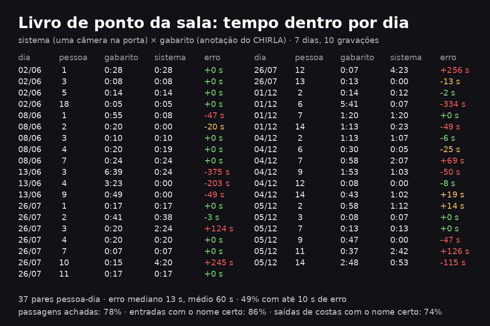
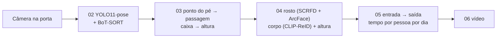
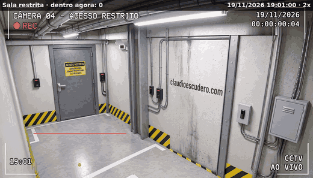

# dwellscope: quem entrou na sala restrita, e por quanto tempo

🌐 [English](README.md) · **Português (Brasil)**

**Uma câmera na porta de uma sala restrita: quem entrou, quem saiu e quanto tempo cada pessoa ficou lá dentro, sem leitor de crachá.**

> Um estudo pessoal de **Claudio Escudero** ([linkedin.com/in/claudioescudero](https://www.linkedin.com/in/claudioescudero/)). Não é um produto nem uma biblioteca. O código está aberto para quem quiser ler, reproduzir os resultados e testar nos próprios vídeos.

<p align="center">
  
</p>

**A pergunta:** câmaras frias, áreas de radiação, salas de máquinas e cofres têm limite de tempo por segurança. Uma câmera só, na porta, consegue auditar quanto tempo cada funcionário passou lá dentro? Quem entra está de frente para a câmera, então o rosto identifica a pessoa. Quem sai mostra só as costas, então o sistema precisa reconhecê-la pela roupa, pelo cabelo e pela altura.

**Resposta curta (vídeo real de escritório, 7 dias):** a ideia se sustenta, e o ponto fraco é a porta. Em 47 minutos de um escritório real, com 14 pessoas ao longo de 7 dias, o rosto identificou 86% de quem entrou. No teste de saída, roupa e cabelo identificaram todos os que saíram de costas (11 de 11; o acaso daria 47%). A roupa só serve dentro do mesmo dia: os participantes trocaram de roupa entre as sessões, e o rosto é o que liga um dia ao outro. O registro de tempo na sala teve erro mediano de 13 s por pessoa por dia, e metade das linhas ficou dentro de 10 s. O resto do erro vem da própria porta. O rastreador perdeu 22% das passagens numa porta pequena e cheia, e uma saída perdida deixa a pessoa "dentro" até o fim da gravação.

<p align="center"></p>

O estudo teve duas fases: um MVP em vídeo sintético, com gabarito exato, e depois vídeo real. As duas estão relatadas abaixo.

## Os dados

**Vídeo real: [CHIRLA](https://github.com/bdager/CHIRLA)** (Dominguez-Dager et al., 2025, [arXiv 2502.06681](https://arxiv.org/abs/2502.06681), CC BY 4.0). Um prédio de laboratórios de uma universidade em Alicante, filmado em 7 dias entre junho e dezembro de 2023 por 7 câmeras, com 22 pessoas que autorizaram a publicação. Cada pessoa tem uma caixa de identidade em cada quadro, e o mesmo número é a mesma pessoa em todos os dias. Os participantes foram orientados a trocar de roupa entre as sessões.

O estudo usa a **câmera 1**: um escritório pequeno (8,5 m², uma porta), filmado do canto oposto à porta. Quem entra caminha em direção à câmera, e quem sai caminha para longe dela. São 10 gravações, de 2 a 9 minutos cada, 47 minutos no total. Passar as caixas de identidade do próprio dataset pela mesma regra de porta do sistema dá o gabarito: 136 passagens pela porta, de 14 pessoas, e o tempo dentro de cada pessoa por dia.

O CHIRLA não tem calibração de câmera, então tudo está em pixels. A câmera foi remontada entre julho e dezembro, por isso há duas linhas de porta, desenhadas à mão.

**MVP sintético: [NVIDIA PhysicalAI-SmartSpaces](https://huggingface.co/datasets/nvidia/PhysicalAI-SmartSpaces)** (AI City Challenge 2025, CC BY 4.0). Vídeo de várias câmeras calibradas, com uma caixa 3D para cada pessoa em cada quadro. A cena de validação `Hospital_000` tem 5 minutos a 30 fps e 41 pessoas. Um salão com um lado aberto faz o papel da sala restrita (paredes em x = −32,4 m e x = −23,5 m, porta em y = 16 m), e a `Camera_21`, dentro dele, olha para a porta. As caixas 3D dão 49 passagens pela porta, de 9 pessoas, a altura real de cada uma e o tempo exato que cada uma ficou dentro.

**Onde baixar.** Nenhum dado está no repositório. Os comandos estão em [Como reproduzir](#como-reproduzir).

| Dados | O que o estudo usa | Tamanho | Download | Licença |
|---|---|---|---|---|
| CHIRLA | Câmera 1: 10 vídeos e as anotações de identidade | 1,36 GB + 21 MB | [ScienceDB](https://doi.org/10.57760/sciencedb.20543), sem conta (baixado pelo [`00_download.py`](scripts/chirla/00_download.py)), ou o [espelho no Hugging Face](https://huggingface.co/datasets/bdager/CHIRLA), depois de aceitar os termos | CC BY 4.0 |
| NVIDIA PhysicalAI-SmartSpaces | A cena de validação `Hospital_000`: `Camera_21`, calibração e gabarito 3D | ~0,6 GB | [Hugging Face](https://huggingface.co/datasets/nvidia/PhysicalAI-SmartSpaces/tree/main/MTMC_Tracking_2025/val/Hospital_000), sem conta (`curl`) | CC BY 4.0 |
| Exemplo `restricted_room` | Um vídeo de 45 s, para o [`dwellscope.py`](scripts/dwellscope.py) | 31 MB | [YouTube](https://youtu.be/CjTEk33Sr8Y), com `yt-dlp` (veja [`samples/README.md`](samples/README.md)) | do autor |

## Como funciona



O pipeline do vídeo real está em [`scripts/chirla/`](scripts/chirla/) e o do sintético em [`scripts/smartspaces/`](scripts/smartspaces/). Cada um tem um script por etapa e um `config.py`. As configurações do rastreador ([`botsort_reid.yaml`](scripts/botsort_reid.yaml)) são compartilhadas.

| Etapa | Vídeo real ([`scripts/chirla/`](scripts/chirla/)) | Sintético ([`scripts/smartspaces/`](scripts/smartspaces/)) |
|---|---|---|
| 0 | [`00_download.py`](scripts/chirla/00_download.py): baixa a câmera 1 do ScienceDB em pedaços paralelos | Comandos `curl` em [Como reproduzir](#como-reproduzir) |
| 1 | [`01_ground_truth.py`](scripts/chirla/01_ground_truth.py): passa as caixas de identidade do CHIRLA pela regra da porta para obter as passagens verdadeiras | [`01_ground_truth.py`](scripts/smartspaces/01_ground_truth.py): o mesmo a partir das caixas 3D, mais as alturas reais |
| 2 | [`02_track.py`](scripts/chirla/02_track.py): YOLO11s-pose a 640 px e BoT-SORT com aparência ([`botsort_reid.yaml`](scripts/botsort_reid.yaml)), um processo por gravação, em GPU | [`02_track.py`](scripts/smartspaces/02_track.py): o mesmo a 960 px, na CPU |
| 3 | [`03_events.py`](scripts/chirla/03_events.py): junta os tracks que o rastreador quebrou na porta e encontra as passagens por uma linha de porta desenhada à mão (pixels). A altura relativa vem da altura da caixa em função da posição do pé, ajustada uma vez por montagem da câmera | [`03_events.py`](scripts/smartspaces/03_events.py): ponto do pé levado ao chão pela calibração; altura em metros pelo topo da caixa |
| 4 | [`04_identify.py`](scripts/chirla/04_identify.py): na entrada, primeiro o rosto, depois a roupa vista antes no mesmo dia, senão uma pessoa nova. Na saída, a melhor entre as pessoas que estão dentro, por roupa, altura e rosto | [`04_identify.py`](scripts/smartspaces/04_identify.py): um único score, cosseno do corpo − 2 × diferença de altura + 0,3 × cosseno do rosto |
| 5 | [`05_evaluate.py`](scripts/chirla/05_evaluate.py): casa as passagens (mesma gravação, mesmo sentido, até 3 s), associa um a um as pessoas do sistema às verdadeiras em todos os dias, soma o tempo por pessoa por dia e roda o teste de saída | [`05_evaluate.py`](scripts/smartspaces/05_evaluate.py): o mesmo para uma cena |
| 6 | [`06_video.py`](scripts/chirla/06_video.py): uma gravação com os nomes, a linha da porta, o contador "dentro agora" e o registro do dia no final | [`06_video.py`](scripts/smartspaces/06_video.py) |

Os dois pipelines seguem as mesmas regras principais:
- A pessoa só muda de lado depois de passar uma margem além da linha da porta (30 px no vídeo real, 0,4 m no sintético).
- Um track novo só recebe um lado quando está claramente longe da linha.
- Passagens opostas do mesmo track em menos de 2 s são alguém parado na porta, e as duas são descartadas.
- Uma saída só é comparada com as pessoas que o sistema acha que estão dentro.

### Os modelos

Quatro modelos treinados rodam no pipeline. Todos são usados como vêm: nenhum foi treinado ou ajustado para este estudo, então os datasets em que foram treinados estão linkados só como referência, sem necessidade de download. Cada modelo responde a uma pergunta.

| Modelo | Pergunta que responde | Entrada → saída | Tamanho | Treinado em |
|---|---|---|---|---|
| **YOLO11s-pose** (Ultralytics, 2024) | Onde está cada pessoa no quadro? | O quadro, redimensionado para 640 px (960 na cena sintética) → uma caixa, uma confiança e 17 pontos do corpo por pessoa | 9,9 M parâmetros, 23,4 GFLOPs, 20 MB | [COCO](https://cocodataset.org/) keypoints |
| **SCRFD-10GF** (`det_10g`, InsightFace `buffalo_l`; Guo et al., 2022) | Há um rosto neste recorte, e onde? | A metade de cima do recorte da pessoa, ampliada para 640 px → caixas de rosto, cinco pontos de referência e um score | 17 MB | [WIDER FACE](http://shuoyang1213.me/WIDERFACE/) |
| **ArcFace ResNet-50** (`w600k_r50`, InsightFace `buffalo_l`; Deng et al., 2019) | De quem é este rosto? | Um rosto de 112 × 112, alinhado pelos pontos de referência → um vetor de 512 números | 174 MB | WebFace600K, part of [WebFace260M](https://www.face-benchmark.org/) |
| **CLIP-ReID** (codificador de imagem ViT do CLIP; Li et al., 2023) | Quem está com esta roupa e este cabelo? | O recorte da pessoa, redimensionado para 256 × 128 → um vetor de 512 números | 345 MB (ONNX) | [Market-1501](https://zheng-lab-anu.github.io/Project/project_reid.html) |

Como cada um é usado:

- **YOLO11s-pose** procura só a classe pessoa. A regra da porta usa a base da caixa como ponto do pé, e a altura da caixa dá a altura relativa. Os 17 pontos do corpo são salvos, mas nenhuma regra os usa ainda.
- **BoT-SORT** (Aharon et al., 2022) liga as caixas de um quadro ao outro, formando os tracks. Não é uma rede separada: ele prevê o movimento de cada caixa com um filtro de Kalman e casa as caixas pela sobreposição e pela aparência, tirada das próprias features do detector. As configurações estão em [`botsort_reid.yaml`](scripts/botsort_reid.yaml): buffer de 60 quadros e sem compensação de movimento da câmera, porque a câmera não se mexe.
- **SCRFD** roda em até 8 recortes por passagem, escolhidos entre as maiores caixas nos 2 s em volta dela. Um rosto só conta com score de pelo menos 0,60, então a câmera precisa ver o rosto com clareza, o que acontece nas entradas e quase nunca nas saídas.
- **ArcFace** transforma o melhor rosto num vetor. Dois rostos cujos vetores têm cosseno de 0,25 ou mais são a mesma pessoa. O limiar usual é 0,35; aqui, com uns 25 px, os rostos são pequenos (veja [O que deu errado](#o-que-deu-errado)).
- **CLIP-ReID** transforma cada recorte num vetor da aparência da pessoa, principalmente roupa e cabelo, e tira a média dos recortes de uma passagem. Ele foi treinado para reidentificar pedestres entre câmeras externas de um campus, vistos de qualquer lado, então funciona de costas também. É ele que identifica as saídas. A roupa muda de um dia para o outro, então esses vetores só são comparados dentro do mesmo dia.
- **A altura** não é um modelo. É uma reta ajustada no próprio vídeo: altura da caixa em função da posição do pé (veja a etapa 3).

Só os dois modelos de rosto do `buffalo_l` são carregados. Os outros (pontos 3D e 2D do rosto, gênero e idade) ficam desligados. Os quatro modelos rodam na CPU, pelo PyTorch e pelo ONNX Runtime; só o rastreamento ganha muito com uma GPU.

**Tempo de execução.** Numa NVIDIA L4, rastrear as 10 gravações reais leva cerca de 9 min. Numa CPU de 16 threads, a mesma execução levaria umas 8 horas. A cena sintética (9.000 quadros a 960 px) levou 17 min na CPU. As etapas 3 a 6 rodam na CPU em poucos minutos.

## Resultados no vídeo real (CHIRLA)

Passagens pela porta: 106 de 136 encontradas, com 15 falsas (precisão 88%, recall 78%).

**Quanto vale cada pista.** O pipeline completo foi rodado de novo com um conjunto de pistas por vez. "Pessoas" é o número de pessoas diferentes que o sistema criou; o certo é 14. O erro de tempo é por pessoa por dia (37 linhas).

| Pistas | Entradas com o nome certo | Saídas com o nome certo | Pessoas | Erro mediano de tempo | Linhas até 10 s |
|---|---|---|---|---|---|
| Só altura | 34% | 26% | 40 | 28 s | 24% |
| Roupa e cabelo (CLIP-ReID) | 34% | 42% | 40 | 20 s | 32% |
| Roupa, cabelo e altura | 38% | 38% | 49 | 24 s | 32% |
| Só rosto (ArcFace) | 84% | 52% | 30 | 32 s | 38% |
| Rosto, roupa e cabelo | 80% | 70% | 21 | 13 s | 49% |
| **Rosto, roupa, cabelo e altura** | **86%** | **74%** | 25 | 13 s | 49% |
| *Passagens detectadas com os nomes verdadeiros* | | | | *0,3 s* | *70%* |

A última linha mantém as passagens detectadas, mas com os nomes verdadeiros. Ela mostra quanto do erro vem só da porta: com a identidade perfeita, 70% das linhas ficam dentro de 10 s. Os outros 30% são passagens perdidas, e são esses os erros grandes (uma saída perdida pode somar 4 minutos). A identificação custa mais 21 pontos.

As pistas dividiram o trabalho como a ideia previa. A roupa sozinha não leva uma pessoa de um dia para o outro, porque todos trocaram de roupa, e as entradas caem para 34%. O rosto sozinho identifica as entradas, mas quase nunca aparece numa saída, que é de costas (houve rosto em 14 das 58 saídas detectadas). Juntos, chegam a 86% das entradas e 74% das saídas.

**O teste de saída.** Ele testa a ideia isoladamente: sabendo quem está dentro, dá para identificar quem sai de costas para a câmera? Foram 11 saídas com duas ou mais pessoas dentro, 2,2 em média.

| Saída identificada por | Acerto |
|---|---|
| Acaso | 47% |
| Rosto | 55% |
| Altura (relativa, pela caixa) | 73% |
| Roupa e cabelo (CLIP-ReID) | 100% |
| Roupa, cabelo e altura | 100% |

Onze saídas é um teste pequeno. Ainda assim, o resultado concorda com o do sintético, abaixo (94%).

## Resultados no vídeo sintético (MVP)

Passagens pela porta: 46 de 49 encontradas, com 2 falsas (precisão 96%, recall 94%). O certo é 9 pessoas.

<p align="center"></p>

| Pistas | Entradas com o nome certo | Saídas com o nome certo | Pessoas | Erro médio no tempo dentro |
|---|---|---|---|---|
| Só rosto (ArcFace) | 10/23 | 5/23 | 21 | 23 s |
| Só altura | 18/23 | 15/23 | 8 | 41 s |
| Roupa e cabelo (CLIP-ReID) | 20/23 | 19/23 | 9 | 13 s |
| Roupa, cabelo e altura | 22/23 | 19/23 | 10 | 17 s |
| **Rosto, roupa, cabelo e altura** | **22/23** | **19/23** | 10 | 17 s |

Para 7 das 9 pessoas, o tempo dentro ficou a até 2 s do certo. Teste de saída (17 saídas, 2,9 pessoas dentro em média): acaso 37%, altura 76%, roupa e cabelo 94%, roupa, cabelo e altura 94%. O rosto, a pista de onde a ideia partiu, foi a mais fraca aqui. Os rostos sintéticos são ruins, e alguns personagens usam máscara. Em rostos reais, o rosto virou a pista mais forte.

## O que deu errado

| Achado | Evidência | O que mudou |
|---|---|---|
| O rastreador quebra as pessoas na porta | No vídeo real, uma pessoa entrando virava muitas vezes três tracks curtos, e nenhum atravessava a faixa da porta inteira | Tracks que começam até 1,5 s e 120 px de onde outro terminou são unidos antes de procurar passagens. O recall subiu de 68% para 72%, e para 78% com uma margem de porta menor (30 px em vez de 45) |
| Um escritório pequeno e cheio esconde os pés | Numa sessão, seis pessoas ficaram em volta de uma mesa perto da porta; uma caixa cortada por quem está na frente faz o ponto do pé saltar em direção à porta | O ponto do pé é a mediana dos últimos 0,5 s, e passagens desfeitas em até 2 s são descartadas, no gabarito e no sistema. Essa sessão (13/06) ainda concentra os maiores erros |
| Uma passagem perdida estraga o dia | Uma saída perdida deixa a pessoa dentro até o fim da gravação (+245 s e +256 s em 26/07); uma entrada perdida apaga a visita | Não foi corrigido na avaliação. O [`dwellscope.py`](scripts/dwellscope.py) lista duas entradas seguidas, entrada sem saída e saída sem entrada em `warnings`, para alguém auditar |
| O limiar de rosto da literatura era rígido demais | Rostos pequenos (cerca de 25 px) pontuam baixo: o cosseno ArcFace da mesma pessoa tem mediana 0,32, e pessoas diferentes ficam abaixo de 0,11 em 95% dos pares | O limiar passou de 0,35 para 0,25. As pessoas criadas caíram de 30 para 25, e as entradas com o nome certo subiram de 82% para 86% |
| A roupa não atravessa os dias | Cosseno da roupa no mesmo dia: mesma pessoa 0,91 de mediana, pessoas diferentes 0,74. Entre dias, os participantes trocaram de roupa | A roupa só é comparada dentro do mesmo dia; o rosto liga os dias |
| A altura em pixels ajuda pouco | Sem calibração, a altura é a altura da caixa em função da posição do pé. Perto da porta, a cabeça muitas vezes é cortada pelo topo da imagem | A altura desempata saídas (73% sozinha), mas separa pessoas nas entradas. Ela fica no pipeline completo com peso pequeno |
| Uma entrada maior não ajudou | Rastrear a 960 px com confiança 0,2 achou 2 passagens a mais e 11 falsas a mais | De volta a 640 px e 0,3 |
| A CPU era lenta demais para 85.000 quadros | Quatro processos na CPU levariam cerca de 8 horas | O rastreamento rodou numa GPU L4 na nuvem (cerca de 9 min); o resto continua na CPU |
| Rostos sintéticos quase não identificam | O ArcFace deu de 0,09 a 0,61 para a mesma pessoa sintética, e até 0,73 para duas pessoas diferentes | Na cena sintética, o rosto é um bônus pequeno (0,3) dentro de um score único |
| O ByteTrack trocou pessoas na porta (sintético) | Duas pessoas passando ao mesmo tempo trocaram de id, e as duas passagens sumiram | BoT-SORT com aparência e buffer de 60 quadros, nas duas fases |

## Como reproduzir

**Requisitos:** Linux, Python 3.12, [uv](https://docs.astral.sh/uv/), FFmpeg e as fontes DejaVu. Uma GPU NVIDIA para a etapa 2 do vídeo real; todo o resto roda na CPU.

```bash
# 1. ambiente (PyTorch para CPU; numa máquina com GPU use a versão CUDA)
uv venv --python 3.12 .venv && source .venv/bin/activate
uv pip install -r requirements.txt --extra-index-url https://download.pytorch.org/whl/cpu

# 2. pesos (~0,7 GB)
mkdir -p weights/insightface/models/buffalo_l
curl -L -o weights/yolo11s-pose.pt https://github.com/ultralytics/assets/releases/download/v8.3.0/yolo11s-pose.pt
curl -L -o weights/person_vit_clip_reid.onnx https://huggingface.co/occurra/person_vit_clip_reid/resolve/main/person_vit_clip_reid.onnx
curl -L -o /tmp/buffalo_l.zip https://github.com/deepinsight/insightface/releases/download/v0.7/buffalo_l.zip
unzip /tmp/buffalo_l.zip -d weights/insightface/models/buffalo_l
```

**Vídeo real (câmera 1 do CHIRLA: 1,36 GB de vídeo e 21 MB de anotações).** O [`00_download.py`](scripts/chirla/00_download.py) baixa tudo do [ScienceDB](https://doi.org/10.57760/sciencedb.20543) (sem conta) para `data/raw/chirla/`. O ScienceDB é lento por conexão, então o script baixa pedaços de 4 MB por 32 conexões, cerca de 8 minutos no total. O [espelho no Hugging Face](https://huggingface.co/datasets/bdager/CHIRLA) também funciona, depois de aceitar os termos.

```bash
cd scripts/chirla
python 00_download.py
python 01_ground_truth.py
python 02_track.py 3          # GPU: ~9 min para as 10 gravações
python 03_events.py
for m in face+body+height face+body body+height body height face; do python 04_identify.py $m; done
python 05_evaluate.py
python 06_video.py seq_025 face+body+height 3
# -> data/output/chirla/dwellscope_chirla_seq_025.mp4
```

**MVP sintético (uma cena do SmartSpaces, ~0,6 GB sem os mapas de profundidade):**

```bash
U=https://huggingface.co/datasets/nvidia/PhysicalAI-SmartSpaces/resolve/main/MTMC_Tracking_2025/val/Hospital_000
mkdir -p data/raw/smartspaces/Hospital_000/videos && cd data/raw/smartspaces/Hospital_000
curl -LO $U/calibration.json -LO $U/ground_truth.json -LO $U/map.png
curl -L -o videos/Camera_21.mp4 $U/videos/Camera_21.mp4
cd -
cd scripts/smartspaces
python 01_ground_truth.py
python 02_track.py            # ~17 min na CPU
python 03_events.py
for m in face+body+height body+height body height face; do python 04_identify.py $m; done
python 05_evaluate.py
python 06_video.py face+body+height 4
# -> data/output/smartspaces/dwellscope_face_body_height.mp4
```

Tudo o que os pipelines geram vai para `data/output/{chirla,smartspaces}/`, que o git ignora.

### Testando no seu próprio vídeo

O [`scripts/dwellscope.py`](scripts/dwellscope.py) roda o pipeline inteiro em qualquer vídeo, sem gabarito. Ele recebe o vídeo e o arquivo da porta, devolve um JSON com o histórico e gera um vídeo anotado se você pedir. Precisa dos passos 1 e 2 acima. Tudo roda na CPU; uma GPU acelera o rastreamento, se houver.

**O exemplo.** O `restricted_room` é um vídeo de 45 s (1890 × 1080, 24 fps) de uma câmera dentro de uma sala restrita, olhando para a porta. Três pessoas entram e saem. Ele está no YouTube, não no repositório: o [`samples/README.md`](samples/README.md) tem o link e o comando que o baixa para `samples/restricted_room.mp4`. Depois, a partir da raiz do repositório:

```bash
python scripts/dwellscope.py samples/restricted_room.mp4 \
    --door samples/restricted_room.door.json \
    --out history.json \
    --video-out anotado.mp4 --speed 2
```

Leva cerca de 1,5 min numa CPU de 16 threads. Sem `--out`, o JSON sai na tela; sem `--video-out`, nenhum vídeo é gerado. `--speed 2` mantém um quadro a cada dois no vídeo.

| Entrada: `samples/restricted_room.mp4` (3× mais rápido) | Saída: `anotado.mp4` (3× mais rápido) |
|---|---|
|  |  |

No vídeo anotado, a linha vermelha é a porta, cada pessoa leva o nome que o sistema deu a ela e a barra de cima conta quem está dentro agora. Uma nota à esquerda diz o que identificou cada passagem. No final aparece o registro das visitas.

**Saída: `history.json`** (resumido: sem os blocos `video` e `door` e o campo `frame`, um item por linha):

```json
{
 "events": [
  {"time_s": 4.0,   "at": "2026-11-19T19:01:04", "kind": "enter", "person": 1, "identified_by": "new",  "face_found": true},
  {"time_s": 12.12, "at": "2026-11-19T19:01:12", "kind": "enter", "person": 2, "identified_by": "new",  "face_found": true},
  {"time_s": 17.62, "at": "2026-11-19T19:01:17", "kind": "enter", "person": 3, "identified_by": "new",  "face_found": true},
  {"time_s": 28.38, "at": "2026-11-19T19:01:28", "kind": "exit",  "person": 2, "identified_by": "look", "score": 0.905, "face_found": false},
  {"time_s": 35.75, "at": "2026-11-19T19:01:35", "kind": "exit",  "person": 3, "identified_by": "look", "score": 0.847, "face_found": false},
  {"time_s": 42.71, "at": "2026-11-19T19:01:42", "kind": "exit",  "person": 1, "identified_by": "only one inside", "score": 0.885, "face_found": false}
 ],
 "visits": [
  {"person": 1, "enter_s": 4.0,  "exit_s": 42.7, "duration_s": 38.7, "enter_at": "2026-11-19T19:01:04", "exit_at": "2026-11-19T19:01:42"},
  {"person": 2, "enter_s": 12.1, "exit_s": 28.4, "duration_s": 16.3, "enter_at": "2026-11-19T19:01:12", "exit_at": "2026-11-19T19:01:28"},
  {"person": 3, "enter_s": 17.6, "exit_s": 35.8, "duration_s": 18.1, "enter_at": "2026-11-19T19:01:17", "exit_at": "2026-11-19T19:01:35"}
 ],
 "people": [{"person": 1, "visits": 1, "time_inside_s": 38.7}, {"person": 2, "visits": 1, "time_inside_s": 16.3}, {"person": 3, "visits": 1, "time_inside_s": 18.1}],
 "warnings": []
}
```

As três entradas são de frente para a câmera, então todas acharam um rosto, e as pessoas eram novas. As três saídas são de costas (`face_found: false`): as duas primeiras foram identificadas pela roupa e pela altura (`look`), e a última era a única pessoa ainda dentro.

**O arquivo da porta** é a única configuração por câmera: a linha da porta, como dois pontos em pixels da imagem, e um ponto qualquer dentro da sala, que diz qual lado é "dentro". A linha pode ter qualquer inclinação. O do exemplo ([`samples/restricted_room.door.json`](samples/restricted_room.door.json)):

```json
{"line": [[200, 810], [760, 810]], "inside": [480, 1000], "margin_px": 30, "start": "2026-11-19T19:01:00"}
```

O `margin_px` é opcional: quanto a pessoa precisa passar da linha para mudar de lado (o padrão é 30 px a cada 720 px de altura da imagem). O `start` também é opcional: a data e hora do primeiro quadro (ISO 8601), que dá um horário a cada evento. Para configurar uma câmera, escolha os dois pontos num quadro do vídeo, escreva o arquivo e confira antes de rodar:

```bash
python scripts/dwellscope.py video.mp4 --door porta.json --check porta.png   # vermelho: a linha; verde: o ponto "dentro"
```

**O JSON** tem quatro listas:
- `events`: cada passagem pela porta, com o tempo, `enter` ou `exit`, a pessoa e o que a identificou (`face` para rosto, `look` para roupa e altura, `new`, `only one inside`, `longest inside`).
- `visits`: cada entrada ligada à saída seguinte da mesma pessoa, com o tempo dentro.
- `people`: as visitas e o tempo total dentro de cada pessoa.
- `warnings`: o que uma câmera de porta não fecha sozinha: saída sem entrada (a pessoa já estava dentro quando o vídeo começou), entrada sem saída (ainda dentro no fim) ou duas entradas seguidas (uma saída foi perdida).

Outros parâmetros: `--start` (substitui o `start` do arquivo da porta), `--cues` (as pistas usadas para identificar: `face+body+height`, `body`, `face`…), `--imgsz` e `--conf` (detector) e `--weights` (pasta dos pesos).

## Estrutura do repositório

```
scripts/
  dwellscope.py         um vídeo + arquivo da porta -> histórico em JSON (e vídeo anotado opcional)
  botsort_reid.yaml     configurações do rastreador, compartilhadas por todos os pipelines
  chirla/               vídeo real: 00_download … 06_video, config.py (linhas da porta, união de tracks),
                        camera1_files.txt (a lista de arquivos do ScienceDB)
  smartspaces/          MVP sintético: 01_ground_truth … 06_video, config.py (sala, calibração)
samples/                o arquivo da porta do vídeo de exemplo, e onde baixar o vídeo (YouTube)
docs/media/             as imagens deste README, nomeadas pela fonte dos dados
data/raw/{chirla,smartspaces}/      dados baixados, ignorados pelo git
data/output/{chirla,smartspaces}/   tudo o que os pipelines geram, ignorado pelo git
weights/                pesos dos modelos baixados, ignorados pelo git
```

## Limitações

- **Sessões curtas.** As gravações reais duram de 2 a 9 minutos, então o relatório do dia cobre minutos, não turnos. O relatório semanal ou mensal é a mesma soma em mais dias e não foi testado em dados longos.
- **Um escritório pequeno, 14 pessoas.** Os limiares (margem da porta, rosto 0,25, roupa 0,85) foram escolhidos nesses mesmos dados, sem um conjunto de teste separado.
- **Linhas de porta desenhadas à mão** e nenhuma calibração: a altura é relativa, e uma câmera que se mexe precisa de uma linha nova.
- **O gabarito usa a mesma regra de porta.** As passagens verdadeiras vêm das caixas de identidade do CHIRLA, que também são cortadas por quem está na frente. Onde o escritório está cheio, o próprio gabarito pode errar uma passagem.
- **Quem já está dentro e nunca cruza a porta** é invisível para um registro de porta, e a avaliação deixa essas pessoas de fora.
- **O `dwellscope.py` roda um vídeo por vez.** As pessoas são numeradas a partir de 1 em cada vídeo, e ninguém é lembrado entre execuções, então ele não soma sozinho o tempo de uma pessoa em vários dias.
- **Rostos.** Os participantes do CHIRLA autorizaram a publicação. Usar reconhecimento facial em funcionários exige consentimento e base legal onde quer que seja implantado.

## Créditos e licenças

- **Código** deste repositório: © 2026 Claudio Escudero, [CC BY-NC 4.0](LICENSE) ([resumo](https://creativecommons.org/licenses/by-nc/4.0/deed.pt-br)). Pode usar, estudar, modificar e compartilhar com crédito, só para fins não comerciais. As bibliotecas e os pesos que ele usa têm licenças próprias, e duas delas restringem ainda mais o uso: o YOLO11 é AGPL-3.0, e os pesos de rosto `buffalo_l` são só para pesquisa não comercial.
- **Dados:** [CHIRLA](https://github.com/bdager/CHIRLA) (Dominguez-Dager, Escalona, Gomez-Donoso e Cazorla, Universidade de Alicante), CC BY 4.0. [NVIDIA PhysicalAI-SmartSpaces](https://huggingface.co/datasets/nvidia/PhysicalAI-SmartSpaces), CC BY 4.0. As imagens `chirla_*` e `smartspaces_*` em `docs/media/` são adaptadas deles (com os nomes, a linha da porta e o registro do sistema desenhados sobre o vídeo) e continuam sob CC BY 4.0. O vídeo de exemplo (no YouTube, veja `samples/README.md`) e os `docs/media/restricted_room_*.gif` são do autor.
- [YOLO11-pose](https://github.com/ultralytics/ultralytics) (Ultralytics), AGPL-3.0, com o rastreador BoT-SORT (Aharon et al., 2022) na implementação da Ultralytics.
- [InsightFace](https://github.com/deepinsight/insightface) `buffalo_l`: SCRFD (Guo et al., ICLR 2022) e ArcFace (Deng et al., CVPR 2019). O código é MIT; os pesos `buffalo_l` são só para pesquisa não comercial.
- [CLIP-ReID](https://github.com/Syliz517/CLIP-ReID) (Li et al., AAAI 2023), MIT, treinado no Market-1501. Exportação ONNX: `occurra/person_vit_clip_reid`.
- OpenCV, Pillow, SciPy, ONNX Runtime e FFmpeg.

O código e os pesos dos modelos não são redistribuídos aqui; eles são baixados dos autores. Confira a licença dos pesos no card de cada modelo antes de reutilizá-los.
