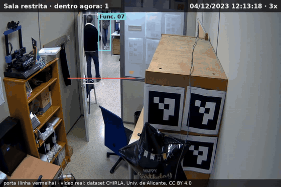
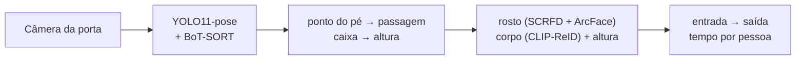
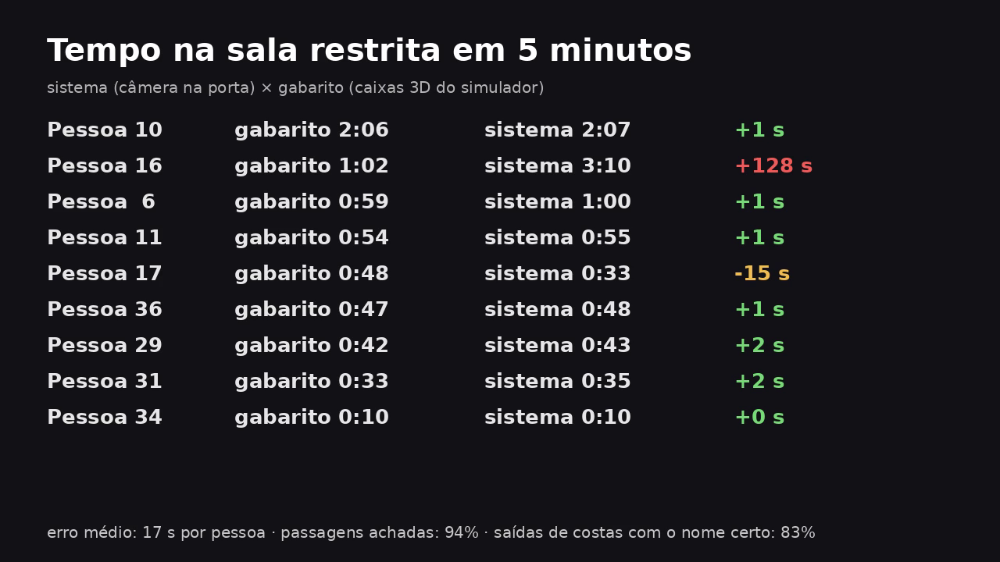
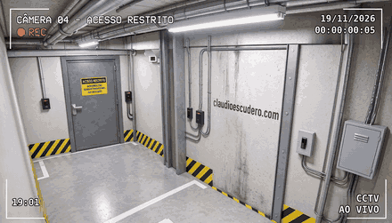

# dwellscope: quem entrou na sala restrita, e por quanto tempo

🌐 [English](README.md) · **Português (Brasil)**

**Uma câmera na porta de uma sala restrita: quem entrou, quem saiu e quanto tempo cada pessoa ficou, sem leitor de crachá.**

> Um estudo pessoal de **Claudio Escudero** ([claudioescudero.com](https://claudioescudero.com) · [linkedin.com/in/claudioescudero](https://www.linkedin.com/in/claudioescudero/)). Não é um produto nem uma biblioteca.

<p align="center">
  
</p>

**A pergunta:** câmaras frias, áreas com radiação e cofres têm limite de tempo por segurança. Uma câmera na porta consegue registrar quanto tempo cada pessoa passou lá dentro? Para isso é preciso identificar quem entra e reconhecer quando essa mesma pessoa sai. Na entrada ela está de frente para a câmera, então o rosto a identifica. Na saída aparecem só as costas, então ela precisa ser reconhecida pela roupa, pelo cabelo e pela altura.

**Resposta curta:** sim, e o ponto fraco é a porta. Em 47 minutos de um escritório real (14 pessoas, 7 dias), o rosto identificou 86% das entradas, e roupa e cabelo identificaram todas as saídas no teste de saída (11 de 11; o acaso daria 47%). O registro de tempo na sala teve erro mediano de 13 s por pessoa por dia. A maior parte do resto vem do rastreador, que perdeu 22% das passagens numa porta pequena e cheia.

<p align="center"></p>

**Para rodar no seu próprio vídeo**, você só precisa do [`scripts/dwellscope.py`](#testando-no-seu-próprio-vídeo). Os scripts `chirla/` e `smartspaces/` servem só para reproduzir o estudo.

## Os dados

| Dados | O que o estudo usa | Download | Licença |
|---|---|---|---|
| [CHIRLA](https://github.com/bdager/CHIRLA) (real, [arXiv 2502.06681](https://arxiv.org/abs/2502.06681)) | Câmera 1: um escritório pequeno com uma porta, 10 gravações, 47 min, 136 passagens de 14 pessoas (1,36 GB) | [ScienceDB](https://doi.org/10.57760/sciencedb.20543) via [`00_download.py`](scripts/chirla/00_download.py), ou o [espelho no Hugging Face](https://huggingface.co/datasets/bdager/CHIRLA) | CC BY 4.0 |
| [NVIDIA PhysicalAI-SmartSpaces](https://huggingface.co/datasets/nvidia/PhysicalAI-SmartSpaces) (MVP sintético) | Cena `Hospital_000`, `Camera_21`: 5 min, 49 passagens de 9 pessoas, com gabarito 3D (~0,6 GB) | [Hugging Face](https://huggingface.co/datasets/nvidia/PhysicalAI-SmartSpaces/tree/main/MTMC_Tracking_2025/val/Hospital_000) | CC BY 4.0 |
| Exemplo `restricted_room` | Um vídeo de 45 s para o `dwellscope.py` (31 MB) | [YouTube](https://youtu.be/CjTEk33Sr8Y), veja [`samples/README.md`](samples/README.md) | do autor |

Os dois datasets marcam cada pessoa em cada quadro, então passar essas marcações pela mesma regra da porta dá o gabarito. O CHIRLA não tem calibração, então as linhas da porta são desenhadas à mão, em pixels.

## Como funciona



1. **Rastrear.** O YOLO11s-pose encontra as pessoas e o BoT-SORT as liga de um quadro para o outro.
2. **Passar.** A base de cada caixa é o ponto do pé. A pessoa só muda de lado depois de passar a linha da porta com uma margem, e um entra-e-sai em menos de 2 s (alguém parado na porta) é descartado.
3. **Identificar.** A entrada é identificada primeiro pelo rosto, depois pela roupa e altura; senão é uma pessoa nova. A saída é comparada só com quem está dentro.
4. **Registrar.** Cada entrada é pareada com a próxima saída da mesma pessoa.

| Modelo | Função | Treinado em |
|---|---|---|
| **YOLO11s-pose** (Ultralytics) | Caixas das pessoas | [COCO](https://cocodataset.org/) |
| **SCRFD-10GF** (InsightFace `buffalo_l`) | Achar o rosto | [WIDER FACE](http://shuoyang1213.me/WIDERFACE/) |
| **ArcFace ResNet-50** (InsightFace `buffalo_l`) | De quem é o rosto (mesma pessoa com cosseno ≥ 0,25) | WebFace600K ([WebFace260M](https://www.face-benchmark.org/)) |
| **CLIP-ReID** (ONNX) | Roupa e cabelo, de qualquer lado | [Market-1501](https://zheng-lab-anu.github.io/Project/project_reid.html) |

Todos são prontos; nenhum foi treinado para este estudo. A altura não é um modelo: é a altura da caixa ajustada contra a posição do pé. Tudo roda na CPU; só o rastreamento ganha muito com GPU (as 10 gravações do CHIRLA levaram 9 min numa L4).

## Resultados no vídeo real (CHIRLA)

Passagens pela porta: 106 de 136 encontradas, 15 falsas (precisão 88%, revocação 78%). Gabarito: 14 pessoas, 37 linhas pessoa-dia.

| Pistas | Entradas certas | Saídas certas | Pessoas criadas | Erro mediano de tempo | Linhas até 10 s |
|---|---|---|---|---|---|
| Só altura | 34% | 26% | 40 | 28 s | 24% |
| Roupa e cabelo | 34% | 42% | 40 | 20 s | 32% |
| Só rosto | 84% | 52% | 30 | 32 s | 38% |
| Rosto, roupa e cabelo | 80% | 70% | 21 | 13 s | 49% |
| **Rosto, roupa, cabelo e altura** | **86%** | **74%** | 25 | 13 s | 49% |
| *Passagens detectadas, nomes verdadeiros* | | | | *0,3 s* | *70%* |

A roupa não liga dias, porque os participantes trocaram de roupa; o rosto quase nunca aparece na saída. Juntos, funcionam. Mesmo com os nomes perfeitos, 30% das linhas erram por mais de 10 s: são as passagens perdidas.

**Teste de saída** (com a lista verdadeira de quem está dentro, identificar quem sai; 11 saídas): acaso 47%, rosto 55%, altura 73%, roupa e cabelo 100%.

## Resultados no vídeo sintético (MVP)

Passagens pela porta: 46 de 49 encontradas, 2 falsas. Com rosto, roupa, cabelo e altura: 22/23 entradas e 19/23 saídas certas, e 7 das 9 pessoas a menos de 2 s do tempo real na sala. Os rostos sintéticos são ruins, então aqui quem fez o trabalho foi a roupa (teste de saída: 94%).

<p align="center"></p>

## O que deu errado

| Achado | O que mudou |
|---|---|
| O rastreador quebra as pessoas em trilhas curtas na porta | Trilhas que começam até 1,5 s e 120 px de onde outra terminou são unidas, e a margem da porta foi de 45 para 30 px. Revocação 68% → 78% |
| No escritório cheio, quem está na frente corta a caixa e o ponto do pé pula | O ponto do pé é a mediana dos últimos 0,5 s |
| Uma saída perdida deixa a pessoa "dentro" até o fim do vídeo (+4 min) | Não corrigido. O `dwellscope.py` avisa em `warnings` |
| Os rostos são pequenos (~25 px), e o limiar usual de 0,35 era rígido demais | 0,25: entradas certas 82% → 86% |
| O ByteTrack trocou duas pessoas passando juntas | BoT-SORT com aparência |

## Como reproduzir

**Requisitos:** Linux, Python 3.12, [uv](https://docs.astral.sh/uv/), FFmpeg. GPU só ajuda no rastreamento do CHIRLA.

```bash
# 1. ambiente (PyTorch para CPU; numa máquina com GPU use a versão CUDA)
uv venv --python 3.12 .venv && source .venv/bin/activate
uv pip install -r requirements.txt --extra-index-url https://download.pytorch.org/whl/cpu

# 2. pesos (~0,7 GB)
mkdir -p weights/insightface/models/buffalo_l
curl -L -o weights/yolo11s-pose.pt https://github.com/ultralytics/assets/releases/download/v8.3.0/yolo11s-pose.pt
curl -L -o weights/person_vit_clip_reid.onnx https://huggingface.co/occurra/person_vit_clip_reid/resolve/main/person_vit_clip_reid.onnx
curl -L -o /tmp/buffalo_l.zip https://github.com/deepinsight/insightface/releases/download/v0.7/buffalo_l.zip
unzip /tmp/buffalo_l.zip -d weights/insightface/models/buffalo_l
```

**Vídeo real (CHIRLA):**

```bash
cd scripts/chirla
python 00_download.py         # ~8 min do ScienceDB, sem conta
python 01_ground_truth.py
python 02_track.py 3          # GPU: ~9 min
python 03_events.py
for m in face+body+height face+body body+height body height face; do python 04_identify.py $m; done
python 05_evaluate.py
python 06_video.py seq_025 face+body+height 3
```

**MVP sintético (SmartSpaces):**

```bash
U=https://huggingface.co/datasets/nvidia/PhysicalAI-SmartSpaces/resolve/main/MTMC_Tracking_2025/val/Hospital_000
mkdir -p data/raw/smartspaces/Hospital_000/videos && cd data/raw/smartspaces/Hospital_000
curl -LO $U/calibration.json -LO $U/ground_truth.json -LO $U/map.png
curl -L -o videos/Camera_21.mp4 $U/videos/Camera_21.mp4
cd - && cd scripts/smartspaces
python 01_ground_truth.py
python 02_track.py            # ~17 min na CPU
python 03_events.py
for m in face+body+height body+height body height face; do python 04_identify.py $m; done
python 05_evaluate.py
python 06_video.py face+body+height 4
```

A saída vai para `data/output/{chirla,smartspaces}/`.

### Testando no seu próprio vídeo

O [`scripts/dwellscope.py`](scripts/dwellscope.py) roda o pipeline inteiro num vídeo: entra o vídeo e o arquivo da porta, sai o histórico em JSON, e um vídeo anotado se você pedir. Ele só precisa dos passos 1 e 2 acima. Com o [exemplo](samples/README.md) baixado:

```bash
python scripts/dwellscope.py samples/restricted_room.mp4 \
    --door samples/restricted_room.door.json \
    --out history.json \
    --video-out anotado.mp4 --speed 2
```

Cerca de 1,5 min numa CPU de 16 threads. Sem `--out` o JSON é impresso; sem `--video-out` nenhum vídeo é gerado.

| Entrada: `samples/restricted_room.mp4` | Saída: `anotado.mp4` |
|---|---|
|  |  |

**Saída: `history.json`** (resumido):

```json
{
 "events": [
  {"time_s": 4.0,   "kind": "enter", "person": 1, "identified_by": "new",  "face_found": true},
  {"time_s": 12.12, "kind": "enter", "person": 2, "identified_by": "new",  "face_found": true},
  {"time_s": 17.62, "kind": "enter", "person": 3, "identified_by": "new",  "face_found": true},
  {"time_s": 28.38, "kind": "exit",  "person": 2, "identified_by": "look", "score": 0.905, "face_found": false},
  {"time_s": 35.75, "kind": "exit",  "person": 3, "identified_by": "look", "score": 0.847, "face_found": false},
  {"time_s": 42.71, "kind": "exit",  "person": 1, "identified_by": "only one inside", "face_found": false}
 ],
 "visits": [
  {"person": 1, "enter_at": "2026-11-19T19:01:04", "exit_at": "2026-11-19T19:01:42", "duration_s": 38.7},
  {"person": 2, "enter_at": "2026-11-19T19:01:12", "exit_at": "2026-11-19T19:01:28", "duration_s": 16.3},
  {"person": 3, "enter_at": "2026-11-19T19:01:17", "exit_at": "2026-11-19T19:01:35", "duration_s": 18.1}
 ],
 "people": [{"person": 1, "visits": 1, "time_inside_s": 38.7}, "..."],
 "warnings": []
}
```

`identified_by` diz o que identificou cada passagem: `face` (rosto), `look` (roupa e altura), `new` (pessoa nova) ou `only one inside` (só havia uma pessoa dentro). `warnings` lista o que o registro não fecha sozinho: saída sem entrada, entrada sem saída, ou duas entradas seguidas.

**O arquivo da porta** é a única configuração por câmera: dois pontos da linha da porta, em pixels, e qualquer ponto dentro da sala ([`samples/restricted_room.door.json`](samples/restricted_room.door.json)):

```json
{"line": [[200, 810], [760, 810]], "inside": [480, 1000], "margin_px": 30, "start": "2026-11-19T19:01:00"}
```

`margin_px` (quanto passar da linha para contar como passagem) e `start` (horário do primeiro quadro) são opcionais. Confira a linha antes de rodar:

```bash
python scripts/dwellscope.py video.mp4 --door porta.json --check porta.png
```

Outras opções: `--start`, `--cues` (`face+body+height`, `body`, `face`…), `--imgsz`, `--conf`, `--weights`.

**Taxa de quadros.** Não é preciso processar todos os quadros. No exemplo, de 24 até 3 fps o registro saiu igual, e com 2 fps passagens se perderam. **6 a 8 fps é uma escolha segura** (não medido numa porta cheia). Converta antes; o script lê o fps do arquivo:

```bash
ffmpeg -i video.mp4 -vf fps=8 -c:v libx264 -crf 18 -an video_8fps.mp4
```

## Estrutura do repositório

```
scripts/
  dwellscope.py       use no seu próprio vídeo
  botsort_reid.yaml   configuração do rastreador
  chirla/             reproduz o estudo, vídeo real (00_download … 06_video)
  smartspaces/        reproduz o estudo, MVP sintético (01_ground_truth … 06_video)
samples/              o arquivo da porta do exemplo e o link no YouTube
docs/media/           as imagens deste README
```

## Limitações

- Gravações curtas (2 a 9 min) de um único escritório pequeno; os limiares foram ajustados nos mesmos dados.
- Linhas da porta desenhadas à mão e sem calibração, então a altura é relativa.
- Quem nunca passa pela porta é invisível para um registro de porta.
- O `dwellscope.py` numera as pessoas a partir de 1 em cada vídeo e não lembra de ninguém entre execuções.
- Reconhecimento facial de funcionários exige consentimento e base legal.

## Créditos e licenças

- **Código:** © 2026 Claudio Escudero, [CC BY-NC 4.0](LICENSE), apenas uso não comercial. O YOLO11 é AGPL-3.0 e os pesos faciais `buffalo_l` são só para pesquisa não comercial.
- **Dados:** [CHIRLA](https://github.com/bdager/CHIRLA) (Dominguez-Dager et al., Universidade de Alicante) e [NVIDIA PhysicalAI-SmartSpaces](https://huggingface.co/datasets/nvidia/PhysicalAI-SmartSpaces), ambos CC BY 4.0. As imagens `chirla_*` e `smartspaces_*` em `docs/media/` são adaptadas deles e continuam CC BY 4.0. O vídeo de exemplo e os `restricted_room_*.gif` são do autor.
- **Modelos:** [Ultralytics YOLO11](https://github.com/ultralytics/ultralytics) com BoT-SORT (Aharon et al., 2022), [InsightFace](https://github.com/deepinsight/insightface) SCRFD (Guo et al., 2022) e ArcFace (Deng et al., 2019), [CLIP-ReID](https://github.com/Syliz517/CLIP-ReID) (Li et al., 2023; ONNX de `occurra/person_vit_clip_reid`). Os pesos são baixados dos autores, não redistribuídos.
